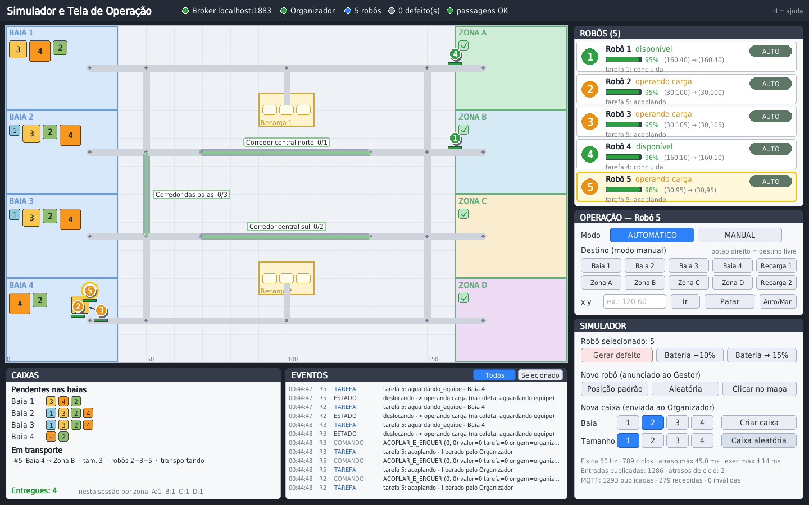

# Simulador e Tela de Operação (Etapa 2)

Uma única aplicação Python (**pygame + paho-mqtt**) com dois papéis, numa janela só
(a tela de operação é a mesma tela do simulador, como o item 9 do enunciado permite):

* **Simulador** (item 8): emula o hardware embarcado de todos os robôs (Tabela 1:
  posição, bateria, falha, acoplamento) e o mapa do galpão, e injeta defeitos, baixa
  a bateria, cria caixas e robôs.
* **Tela de Operação** (item 7): mostra posições, status em ícones, caixas pendentes
  e entregues, eventos; troca manual/automático e envia destinos ao Organizador.



## Instalação

```sh
pip install -r simulador/requirements.txt     # pygame e paho-mqtt
sudo apt install mosquitto                    # o broker MQTT
make                                          # compila o C++ e gera bin/mapa.json
```

## Como rodar o sistema completo

Três terminais, **a partir da raiz do projeto**:

```sh
# 1. broker MQTT (se o serviço do mosquitto já estiver rodando, pule este passo)
mosquitto -p 1883

# 2. Organizador (sobe o Gestor de Robôs e o Coletor). ATR_HW=mqtt faz os processos
#    dos robôs usarem o hardware DESTE simulador em vez da física interna do C++
ATR_HW=mqtt ./bin/org_logistica

# 3. simulador + tela de operação
python3 simulador/main.py          # ou:  make sim   /   python3 -m simulador
```

Opções: `--host`/`--porta` (ou `ATR_MQTT_HOST`/`ATR_MQTT_PORT`), `--mapa arquivo.json`,
`--sem-janela` (só física e MQTT, sem tela), `--capturar arq.png` (salva uma captura e sai), `-v`.

O mapa vem de `bin/mapa.json` (gerado por `make`, ou por `bin/mapa json > bin/mapa.json`):
o C++ continua sendo a fonte única da geometria. Se o arquivo não existir, o simulador o gera.

**Pré-requisitos do lado C++** (já no `org_logistica_init.cpp`): o Gestor precisa rodar com
`--fonte mqtt` (é de onde ele lê os `NOVO_ROBO` desta tela) e o Organizador precisa esperar o
Gestor criar a `/atr_frota` antes de abri-la.

> **WSL**: a janela exige o WSLg (Windows 11). Sem ele, use `--sem-janela`, ou rode o
> simulador no Python do Windows apontando para o broker (`--host localhost`) e copie
> `bin/mapa.json` para lá (`--mapa`).

## Usando a tela

| Região | O que faz |
|---|---|
| **Mapa** (centro) | Baias à esquerda, zonas à direita, estações de recarga, corredores. Robôs coloridos por estado, com selo **M** (manual), ⚠ (defeito), ⚡ (recarregando), ⏳ (esperando passagem) e barra de bateria. Caixas pendentes dentro das baias; a caixa com equipe já designada **continua na baia (borda azul) até ser coletada**, então desliza até a equipe; entregues (✓) dentro das zonas. Os robôs que carregam uma caixa são desenhados **nos lados/cantos dela** (1-2 robôs nos lados, 3 em T, 4 nos cantos), mesmo que a navegação os deixe no mesmo ponto (é só desenho: a posição física e a conferência de passagens não mudam). Cada passagem estreita mostra `ocupação/capacidade` (laranja = cheia, **vermelho piscando = violação**) |
| **ROBÔS** | Um cartão por robô (estado, bateria, posição → destino, fase da tarefa). A pílula **AUTO/MANUAL** troca o modo |
| **OPERAÇÃO** | Para o robô selecionado: modo, destino rápido (Baia 1-4, Zona A-D, Recarga 1-2), campo `x y`, Parar. Destino só vale em **modo manual** (em automático a tela avisa) |
| **SIMULADOR** | Gerar/reparar defeito, bateria −10% ou → 15%, **novo robô** (posição padrão, aleatória ou clicando no mapa), **nova caixa** (baia e tamanho) e as estatísticas da física |
| **CAIXAS / EVENTOS** | Pendentes por baia (as com equipe a caminho com borda azul), missões com estado *buscando* / *transportando*, total entregue; log em tempo real com filtro por robô |

Mouse: clique no robô seleciona; **botão direito no mapa** envia destino arbitrário ao selecionado (manual).
Teclado: `Tab` próximo robô · `M` modo · `F` defeito · `B` bateria −10% · `Espaço` parar · `N` nomes dos nós ·
`F11` tela cheia · `F12` captura em `capturas/` · `H` ajuda. A janela é redimensionável.

## Protocolo MQTT (espelha `comum/mqtt_topicos.hpp`)

| Direção | Tópico | Payload |
|---|---|---|
| sim → robô | `atr/robo/<id>/entradas` (a cada 50 ms, QoS 0) | `x y atracada bateria falha` |
| robô → sim | `atr/robo/<id>/saidas` | `sp_x sp_y acoplar` |
| robô → sim | `atr/robo/<id>/vivo` (retida) | `online` / `offline` (will) |
| tela → Gestor | `atr/robos/novo` | `NOVO_ROBO <id> [x y]` |
| tela → Organizador | `atr/operacao/cmd` | `MODO <id> manual\|auto`, `IR <id> <x> <y>`, `PARAR <id>`, `CAIXA <baia> <tam>` |
| Organizador → tela | `atr/frota/status`, `atr/cargas`, `atr/eventos` | JSON |
| qualquer → sim | `atr/sim/cmd` | `FALHA <id> 0\|1`, `BATERIA <id> <pct>` (compatível com `ferramentas/sim_falso.py`) |

Um robô passa a existir no simulador quando chega o primeiro `saidas` dele (o setpoint inicial é a
posição pedida ao Gestor) e some quando o `vivo` vira `offline`. Se o simulador for reiniciado com
robôs vivos, ele os **adota** (online + presentes no status do Organizador) na posição e bateria
lembradas, senão eles declarariam defeito por falta de entradas (timeout de 1 s).

## Física (`fisica.py`, espelha `robo/config_robo.hpp`)

Linha reta até o setpoint a 40 un/s; bateria −0,5 %/s andando e −0,05 %/s parado; +20 %/s parado numa
área de recarga (sem defeito); sem defeito e com bateria > 0 para andar; `i_carga_atracada` sobe
0,5 s depois de `o_acoplar_e_erguer` e cai quando o comando é retirado.

## Arquitetura e concorrência

```
 paho (thread de rede) ──▶ Mundo (lock) ◀── thread de FÍSICA (50 Hz) ──▶ publica entradas (50 ms)
        │                      ▲                                           confere passagens
        └──▶ EstadoOperacao    │ snapshot
             (lock)  ▲         │
                     └─ thread principal: pygame (30 FPS) ── Controle (regras) ──▶ Rede.publicar
```

* `fisica.MotorFisica` roda numa **thread própria**, e não no laço da tela: arrastar a janela ou um
  quadro lento não atrasam os robôs (o robô declara defeito se ficar 1 s sem entradas).
* O callback do paho **só atualiza estado** (sob `Mundo.lock` / `EstadoOperacao.lock`); nunca desenha
  nem espera. A tela trabalha sobre *snapshots*.
* `controle.py` concentra as regras do operador (só `IR` em manual, ids sem repetição, limite de 32
  robôs, aviso se o Gestor não criar o processo em 5 s) e não depende de pygame: é testável sem janela.
* A conferência de passagens usa as posições reais da física e conta uma **violação** quando há mais
  robôs dentro de um corredor estreito do que sua capacidade; o aviso nomeia os robôs e as posições.
  Robô esperando no nó de entrada ainda não está dentro.

## Testes

```sh
make teste-simulador-unit   # 69 testes, ~2 s, sem broker e sem janela
make teste-simulador        # integração: broker + Organizador real + simulador (clica nos botões)
```

A integração (`simulador/testes/integracao.py`, via `testes/teste_simulador.sh`) cria robôs, caixas,
transporte colaborativo e entregas, modo manual com os três tipos de destino, defeito, recarga,
morte do processo de um robô e **reinício do simulador com adoção**, e salva capturas em
`run/teste_simulador/`.

### Medindo o aproveitamento da frota

```sh
./testes/teste_ocupacao.sh [robôs] [segundos]     # padrão: 5 robôs, até 150 s (make teste-ocupacao)
```

Sobe N robôs em posições fixas e amostra o status do Organizador a cada 100 ms até todas as caixas
serem entregues. Imprime o **tempo até entregar tudo**, as missões simultâneas (média e máximo) e a
**ociosidade evitável**: tempo em que há robôs ociosos em número suficiente para a menor caixa pendente
(alguma equipe poderia estar trabalhando e não está). `OCUPACAO_DIAG=1` imprime o estado detalhado
nesses momentos. As execuções variam entre si (as threads do Organizador não são determinísticas):
compare várias.

Desempenho medido (máquina de 1 núcleo, sem GPU): com **32 robôs** o pior ciclo de física levou
~1,8 ms (orçamento de 20 ms), 536 entradas/s publicadas e 3,9 ms por quadro de desenho
(limite de 33 ms para 30 FPS).

## Limitações conhecidas

* `atr/eventos` não é retido: depois de abrir a tela, as entregas por zona (✓ nas zonas) contam só a
  sessão; o total geral (`Entregues`) vem de `atr/cargas` e é completo.
* O ✓ de caixa entregue não mostra o tamanho (o registro de carga não o informa).
* A formação dos robôs em torno da caixa é só visual; a posição física de cada robô continua a que a
  navegação define (e é ela que o simulador usa para conferir as passagens).
* Os robôs não colidem entre si na física: evitar colisão é papel da navegação (a tela só confere a
  capacidade das passagens estreitas).
